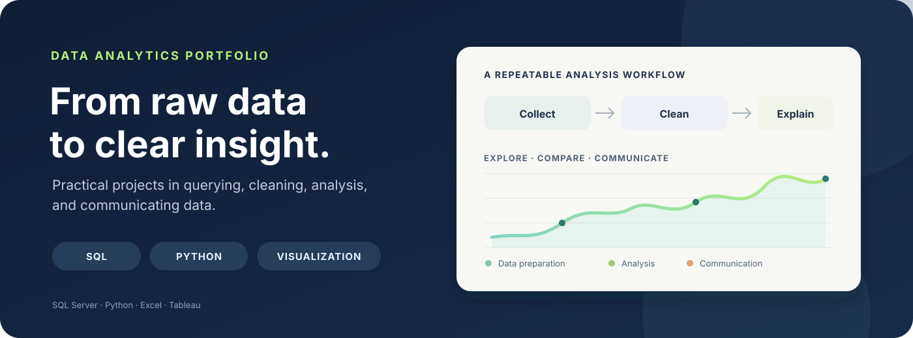

# Data Analytics Portfolio



A collection of hands-on projects exploring how to collect, clean, analyze, and communicate data. The work spans SQL Server, Python notebooks, spreadsheets, and Tableau-oriented analysis.

## At a glance

| Focus | What you’ll find |
| --- | --- |
| **SQL analysis** | COVID-19 trends, Nashville housing data cleaning, and analysis prepared for Tableau |
| **Python** | Web scraping, API data collection, and movie industry exploration |
| **Data workflow** | Joins, cleaning, aggregation, window functions, reshaping, and time-based tracking |

## Featured projects

### COVID-19 data exploration
Analyze cases, deaths, infection rates, and vaccination progress with SQL joins, aggregates, common table expressions, window functions, temporary tables, and views.

- [Exploration queries](<COVID Portfolio Project - Data Exploration.sql>)
- [Tableau-oriented queries](<Tableau Portfolio Project SQL Queries.sql>)
- Data files: [deaths](CovidDeaths.xlsx) and [vaccinations](CovidVaccinations.xlsx)

### Nashville housing data cleaning
Prepare housing records for analysis by standardizing dates, filling missing addresses from matching parcel records, splitting address fields, normalizing the “Sold as Vacant” values, and identifying duplicates.

- [Cleaning queries](<Data Cleaning Portfolio Project Queries.sql>)
- [Housing data](<Nashville Housing Data for Data Cleaning.xlsx>)

### Movie industry exploration
Use a Python notebook to inspect and explore movie data with pandas, NumPy, Seaborn, and Matplotlib.

- [Open the notebook](<Movie Portfolio Project.ipynb>)

### Cryptocurrency API extraction
Collect cryptocurrency listing data from the CoinMarketCap API, normalize the response into a dataframe, append repeated snapshots, and explore price and percentage-change trends.

- [Open the notebook](<Automate API Extraction + Appending Data + Extra -- Project.ipynb>)
- Requires an API key and an active CoinMarketCap API plan. Set `CMC_API_KEY` in your environment before running the notebook.

### Amazon product price scraper
Use Python requests and Beautiful Soup to collect a product title and price, add a collection date, and save the results to CSV.

- [Open the notebook](<Amazon Web Scraper Project.ipynb>)

### Tableau joins exercise
A small spreadsheet exercise supporting practice with combining data sources.

- [Open the workbook](<Tableau Joins File.xlsx>)

## Getting started

### SQL projects

The SQL scripts use SQL Server syntax and refer to a database named `PortfolioProject`. Update the database and table names to match your local setup before running them. Some scripts alter or drop columns, so review them and work from a copy of the source data.

### Python notebooks

Use Python 3 and install the packages used across the notebooks:

```bash
python -m pip install jupyter pandas numpy requests beautifulsoup4 seaborn matplotlib
python -m jupyter notebook
```

The API notebook reads its credential from the `CMC_API_KEY` environment variable. For PowerShell:

```powershell
$env:CMC_API_KEY = "your-api-key"
```

For macOS or Linux:

```bash
export CMC_API_KEY="your-api-key"
```

Do not commit API keys or other credentials. Some notebooks also contain example local file paths; change those paths to locations on your computer.

## Tools and techniques

**SQL Server** · **Python** · **pandas** · **NumPy** · **Requests** · **Beautiful Soup** · **Seaborn** · **Matplotlib** · **Excel** · **Tableau**

## Repository contents

This repository includes notebooks, SQL scripts, and sample workbooks. The notebooks and scripts are the project materials; the spreadsheet files provide data or practice inputs where applicable.

---

*Portfolio projects created for learning and practice. Data and API availability may change over time.*
